<!-- 由 scripts/gen-package-graph.mts 生成，不要手改。
     跑 `pnpm gen:package-graph` 重新生成；CI 校验本文件是否最新。 -->

# 包依赖图（生成物）

每个包属于哪一层由它的 `package.json` 声明（`"nide": { "layer": ... }`）；边是**真实 import 扫描**的结果（与 `pnpm lint:imports` 同一份解析）。共 38 个节点 / 117 条包级依赖 / 477 条跨包 import。

实线 = 运行时 import；虚线 = 只有 `import type`（不产生运行时代码）。

```mermaid
flowchart TD
  subgraph layer_domain["domain"]
    pkg_packages_domain["domain"]
  end
  subgraph layer_contract["contract"]
    pkg_packages_contracts["contracts"]
  end
  subgraph layer_kernel["kernel"]
    pkg_packages_kernel["kernel"]
  end
  subgraph layer_service["service"]
    pkg_packages_ai["ai"]
    pkg_packages_appearance["appearance"]
    pkg_packages_config["config"]
    pkg_packages_content["content"]
    pkg_packages_git["git"]
    pkg_packages_i18n["i18n"]
    pkg_packages_plugin_backend["plugin-backend"]
    pkg_packages_plugin_capabilities["plugin-capabilities"]
    pkg_packages_plugin_permissions["plugin-permissions"]
    pkg_packages_plugin_runtime["plugin-runtime"]
    pkg_packages_plugin_storage["plugin-storage"]
    pkg_packages_project["project"]
    pkg_packages_secrets["secrets"]
  end
  subgraph layer_bootstrap["bootstrap"]
    pkg_packages_boot["boot"]
    pkg_packages_host["host"]
  end
  subgraph layer_shell["shell"]
    pkg_packages_shell["shell"]
  end
  subgraph layer_client_platform["client-platform"]
    pkg_packages_client_kit["client-kit"]
  end
  subgraph layer_client_sdk["client-sdk"]
    pkg_packages_sdk["sdk"]
  end
  subgraph layer_client_seam["client-seam"]
    pkg_packages_client_modules["client-modules"]
    pkg_packages_client_ui_renderer["client-ui-renderer"]
    pkg_packages_client_ui_slots["client-ui-slots"]
  end
  subgraph layer_client_feature["client-feature"]
    pkg_packages_client_ui_editor["client-ui-editor"]
    pkg_packages_client_ui_explorer["client-ui-explorer"]
    pkg_packages_client_ui_git["client-ui-git"]
    pkg_packages_client_ui_plugins["client-ui-plugins"]
  end
  subgraph layer_client_window["client-window"]
    pkg_packages_client_ui_main["client-ui-main"]
    pkg_packages_client_ui_settings["client-ui-settings"]
    pkg_packages_client_ui_welcome["client-ui-welcome"]
  end
  subgraph layer_client_runtime["client-runtime"]
    pkg_packages_client_runtime["client-runtime"]
  end
  subgraph layer_plugin["plugin"]
    pkg_packages_plugins_ai_provider["plugins/ai-provider"]
    pkg_packages_plugins_demo["plugins/demo"]
    pkg_packages_plugins_lang_en["plugins/lang-en"]
  end
  subgraph layer_bundle["bundle"]
    pkg_packages_bundle_base["bundle/base"]
  end
  subgraph layer_smoke["smoke"]
    pkg_packages_hello["hello"]
  end
  subgraph layer_app["app"]
    pkg_apps_desktop_renderer["apps/desktop/renderer"]
  end
  pkg_apps_desktop_renderer --> pkg_packages_client_kit
  pkg_apps_desktop_renderer --> pkg_packages_client_runtime
  pkg_apps_desktop_renderer --> pkg_packages_client_ui_editor
  pkg_apps_desktop_renderer --> pkg_packages_client_ui_renderer
  pkg_apps_desktop_renderer --> pkg_packages_contracts
  pkg_apps_desktop_renderer --> pkg_packages_domain
  pkg_packages_ai --> pkg_packages_contracts
  pkg_packages_ai -.-> pkg_packages_kernel
  pkg_packages_appearance --> pkg_packages_contracts
  pkg_packages_appearance --> pkg_packages_kernel
  pkg_packages_boot --> pkg_packages_kernel
  pkg_packages_client_kit --> pkg_packages_contracts
  pkg_packages_client_kit --> pkg_packages_domain
  pkg_packages_client_modules --> pkg_packages_contracts
  pkg_packages_client_runtime --> pkg_packages_client_modules
  pkg_packages_client_runtime --> pkg_packages_client_ui_editor
  pkg_packages_client_runtime --> pkg_packages_client_ui_explorer
  pkg_packages_client_runtime --> pkg_packages_client_ui_git
  pkg_packages_client_runtime --> pkg_packages_client_ui_main
  pkg_packages_client_runtime --> pkg_packages_client_ui_settings
  pkg_packages_client_runtime --> pkg_packages_client_ui_slots
  pkg_packages_client_runtime --> pkg_packages_client_ui_welcome
  pkg_packages_client_ui_editor --> pkg_packages_client_kit
  pkg_packages_client_ui_editor --> pkg_packages_client_ui_renderer
  pkg_packages_client_ui_editor --> pkg_packages_client_ui_slots
  pkg_packages_client_ui_editor -.-> pkg_packages_contracts
  pkg_packages_client_ui_editor --> pkg_packages_domain
  pkg_packages_client_ui_explorer --> pkg_packages_client_kit
  pkg_packages_client_ui_explorer --> pkg_packages_client_ui_renderer
  pkg_packages_client_ui_explorer --> pkg_packages_client_ui_slots
  pkg_packages_client_ui_explorer --> pkg_packages_contracts
  pkg_packages_client_ui_explorer --> pkg_packages_domain
  pkg_packages_client_ui_git --> pkg_packages_client_kit
  pkg_packages_client_ui_git --> pkg_packages_client_ui_renderer
  pkg_packages_client_ui_git --> pkg_packages_client_ui_slots
  pkg_packages_client_ui_git --> pkg_packages_contracts
  pkg_packages_client_ui_main --> pkg_packages_client_kit
  pkg_packages_client_ui_main --> pkg_packages_client_modules
  pkg_packages_client_ui_main --> pkg_packages_client_ui_renderer
  pkg_packages_client_ui_main --> pkg_packages_client_ui_slots
  pkg_packages_client_ui_main --> pkg_packages_contracts
  pkg_packages_client_ui_plugins --> pkg_packages_client_kit
  pkg_packages_client_ui_plugins -.-> pkg_packages_contracts
  pkg_packages_client_ui_renderer --> pkg_packages_client_kit
  pkg_packages_client_ui_renderer -.-> pkg_packages_client_modules
  pkg_packages_client_ui_renderer --> pkg_packages_client_ui_slots
  pkg_packages_client_ui_renderer --> pkg_packages_contracts
  pkg_packages_client_ui_renderer --> pkg_packages_sdk
  pkg_packages_client_ui_settings --> pkg_packages_client_kit
  pkg_packages_client_ui_settings --> pkg_packages_client_ui_plugins
  pkg_packages_client_ui_settings --> pkg_packages_client_ui_slots
  pkg_packages_client_ui_settings -.-> pkg_packages_contracts
  pkg_packages_client_ui_settings --> pkg_packages_sdk
  pkg_packages_client_ui_welcome --> pkg_packages_client_kit
  pkg_packages_client_ui_welcome --> pkg_packages_client_ui_plugins
  pkg_packages_client_ui_welcome --> pkg_packages_client_ui_slots
  pkg_packages_client_ui_welcome -.-> pkg_packages_contracts
  pkg_packages_client_ui_welcome --> pkg_packages_domain
  pkg_packages_config --> pkg_packages_domain
  pkg_packages_config -.-> pkg_packages_kernel
  pkg_packages_content --> pkg_packages_contracts
  pkg_packages_content --> pkg_packages_domain
  pkg_packages_content -.-> pkg_packages_kernel
  pkg_packages_git --> pkg_packages_contracts
  pkg_packages_git -.-> pkg_packages_kernel
  pkg_packages_host -.-> pkg_packages_ai
  pkg_packages_host -.-> pkg_packages_appearance
  pkg_packages_host --> pkg_packages_boot
  pkg_packages_host -.-> pkg_packages_config
  pkg_packages_host -.-> pkg_packages_contracts
  pkg_packages_host -.-> pkg_packages_i18n
  pkg_packages_host --> pkg_packages_kernel
  pkg_packages_host -.-> pkg_packages_plugin_backend
  pkg_packages_host -.-> pkg_packages_plugin_capabilities
  pkg_packages_host -.-> pkg_packages_plugin_permissions
  pkg_packages_host -.-> pkg_packages_plugin_runtime
  pkg_packages_host -.-> pkg_packages_plugin_storage
  pkg_packages_host -.-> pkg_packages_project
  pkg_packages_i18n --> pkg_packages_contracts
  pkg_packages_i18n -.-> pkg_packages_kernel
  pkg_packages_kernel --> pkg_packages_contracts
  pkg_packages_plugin_backend -.-> pkg_packages_contracts
  pkg_packages_plugin_backend -.-> pkg_packages_kernel
  pkg_packages_plugin_backend -.-> pkg_packages_plugin_capabilities
  pkg_packages_plugin_backend -.-> pkg_packages_plugin_permissions
  pkg_packages_plugin_backend -.-> pkg_packages_plugin_runtime
  pkg_packages_plugin_backend -.-> pkg_packages_plugin_storage
  pkg_packages_plugin_capabilities --> pkg_packages_contracts
  pkg_packages_plugin_capabilities --> pkg_packages_kernel
  pkg_packages_plugin_capabilities -.-> pkg_packages_plugin_runtime
  pkg_packages_plugin_permissions --> pkg_packages_contracts
  pkg_packages_plugin_permissions -.-> pkg_packages_kernel
  pkg_packages_plugin_permissions -.-> pkg_packages_plugin_runtime
  pkg_packages_plugin_runtime --> pkg_packages_contracts
  pkg_packages_plugin_runtime -.-> pkg_packages_i18n
  pkg_packages_plugin_runtime -.-> pkg_packages_kernel
  pkg_packages_plugin_runtime -.-> pkg_packages_plugin_backend
  pkg_packages_plugin_runtime -.-> pkg_packages_plugin_permissions
  pkg_packages_plugin_runtime -.-> pkg_packages_plugin_storage
  pkg_packages_plugin_storage -.-> pkg_packages_kernel
  pkg_packages_plugins_ai_provider -.-> pkg_packages_client_ui_settings
  pkg_packages_plugins_ai_provider --> pkg_packages_contracts
  pkg_packages_plugins_ai_provider -.-> pkg_packages_kernel
  pkg_packages_plugins_ai_provider --> pkg_packages_sdk
  pkg_packages_plugins_demo --> pkg_packages_client_kit
  pkg_packages_plugins_demo --> pkg_packages_client_ui_renderer
  pkg_packages_plugins_demo -.-> pkg_packages_contracts
  pkg_packages_plugins_demo -.-> pkg_packages_kernel
  pkg_packages_plugins_demo --> pkg_packages_sdk
  pkg_packages_plugins_lang_en -.-> pkg_packages_kernel
  pkg_packages_project --> pkg_packages_domain
  pkg_packages_project -.-> pkg_packages_kernel
  pkg_packages_sdk --> pkg_packages_contracts
  pkg_packages_secrets --> pkg_packages_contracts
  pkg_packages_secrets --> pkg_packages_kernel
  pkg_packages_shell --> pkg_packages_contracts
  pkg_packages_shell --> pkg_packages_domain
```

## 层与允许的依赖

| 层 | 包 | 允许依赖 |
| --- | --- | --- |
| `domain` | `domain` | （无） |
| `contract` | `contracts` | （无） |
| `kernel` | `kernel` | `domain`, `contract` |
| `service` | `ai` `appearance` `config` `content` `git` `i18n` `plugin-backend` `plugin-capabilities` `plugin-permissions` `plugin-runtime` `plugin-storage` `project` `secrets` | `domain`, `contract`, `kernel` |
| `bootstrap` | `boot` `host` | `domain`, `contract`, `kernel`, `service`, `bootstrap`, `smoke` |
| `shell` | `shell` | `domain`, `contract` |
| `client-platform` | `client-kit` | `domain`, `contract` |
| `client-sdk` | `sdk` | `domain`, `contract`, `client-platform` |
| `client-seam` | `client-modules` `client-ui-renderer` `client-ui-slots` | `domain`, `contract`, `client-platform`, `client-sdk`, `client-seam` |
| `client-feature` | `client-ui-editor` `client-ui-explorer` `client-ui-git` `client-ui-plugins` | `domain`, `contract`, `client-platform`, `client-sdk`, `client-seam` |
| `client-window` | `client-ui-main` `client-ui-settings` `client-ui-welcome` | `domain`, `contract`, `client-platform`, `client-sdk`, `client-seam`, `client-feature` |
| `client-runtime` | `client-runtime` | `domain`, `contract`, `client-platform`, `client-sdk`, `client-seam`, `client-feature`, `client-window` |
| `plugin` | `plugins/ai-provider` `plugins/demo` `plugins/lang-en` | `domain`, `contract`, `client-platform`, `client-sdk`, `client-seam` |
| `bundle` | `bundle/base` | （无） |
| `smoke` | `hello` | （无） |
| `app` | `apps/desktop/renderer` | `domain`, `contract`, `client-platform`, `client-sdk`, `client-seam`, `client-feature`, `client-window`, `client-runtime` |

## 怎么读这张图

- 一条边的方向是「谁 import 谁」，不是「谁启动谁」；Cordis 的启动顺序由 `inject` 决定。
- 允许的依赖只限制**跨层**；同层内服务之间也只能 `import type`（见 `check-imports` 的说明）。
- 想加一条新边：先确认它落在「允许依赖」里，再改代码；图会跟着变，记得重新生成。
